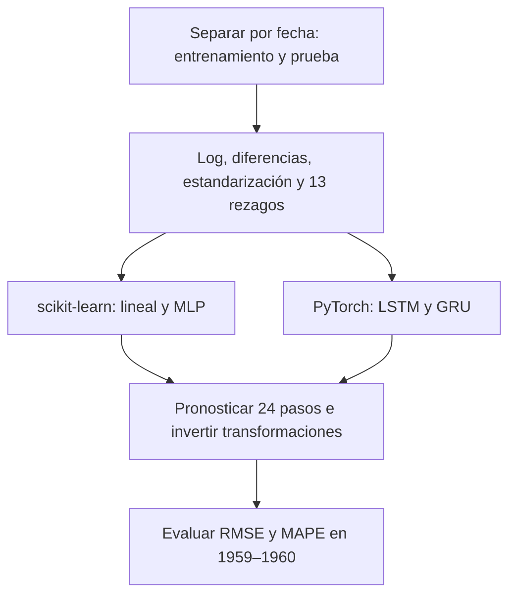
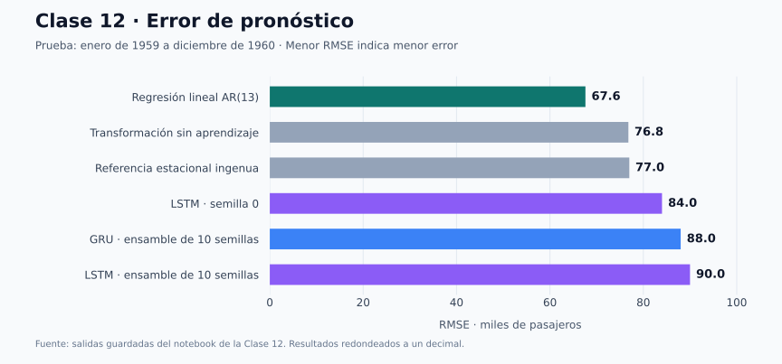
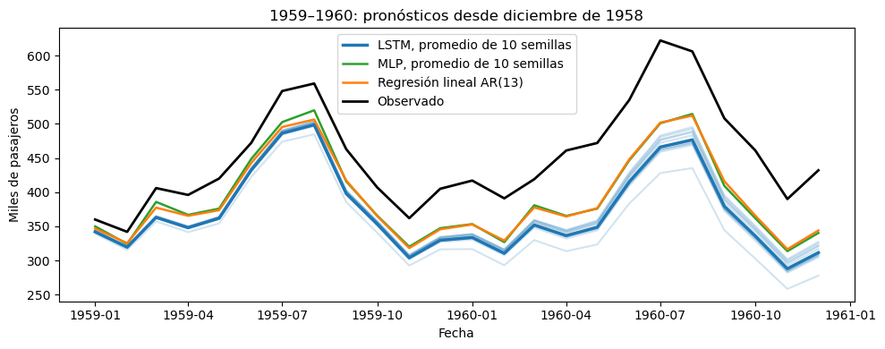

<p align="center">
  
</p>

<h1 align="center">Statistics for Data Science</h1>

<p align="center">
  Un recorrido práctico por el análisis de datos, la estadística y el modelado con Python.<br>
  <strong>Datos reales · Notebooks explicados · De la estadística a las redes neuronales</strong>
</p>

<p align="center">
  
  
  
  
  
</p>

<p align="center">
  <a href="#clase-12">🧠 Explorar la clase 12</a> ·
  <a href="#ruta-de-aprendizaje">Ruta de aprendizaje</a> ·
  <a href="#notebooks">Notebooks</a> ·
  <a href="#inicio-rápido">Inicio rápido</a> ·
  <a href="#tecnologías">Tecnologías</a> ·
  <a href="#datos-y-fuentes">Datos y fuentes</a> ·
  <a href="#análisis-en-detalle">Análisis en detalle</a>
</p>

---

Este repositorio reúne los ejercicios de la materia **Statistics for Data Science**: desde la exploración y limpieza de datos hasta la evaluación de modelos y el análisis de series de tiempo. Cada notebook documenta la carga, la preparación y el análisis de los datos con ejemplos de movilidad, alojamientos, salud y medio ambiente.

| 🔎 Quiero aprender desde cero | 🧠 Quiero comparar modelos | 🚀 Quiero ejecutar el código |
| :---: | :---: | :---: |
| Sigue la [ruta de las 12 clases](#ruta-de-aprendizaje). | Explora los [resultados de la clase 12](#clase-12). | Prepara el entorno en [Inicio rápido](#inicio-rápido). |

## Ruta de aprendizaje

| Etapa | Clases | Lo que se practica |
| :--- | :---: | :--- |
| 🔎 **Explorar y preparar** | 1–2 | Análisis exploratorio, visualización, limpieza y pipelines ETL. |
| 📊 **Medir y comparar** | 3–4 | Métricas de clasificación y regresión, errores y desbalance de clases. |
| 🌎 **Analizar datos reales** | 5–8 | Calidad del aire, probabilidad, regresión, correlación e influencia. |
| 📈 **Entender el tiempo** | 9–11 | Estacionariedad, autocorrelación, modelos SARIMA y bases para el pronóstico. |
| 🧠 **Comparar modelos de pronóstico** | [12](#clase-12) | Regresión AR(13), MLP, LSTM y GRU; validación temporal y variabilidad entre semillas. |

<details>
<summary><strong>Objetivos del repositorio</strong></summary>

- Practicar análisis exploratorio con datos reales y sintéticos.
- Construir pipelines básicos de ETL: ingesta, limpieza, transformación y validación.
- Crear variables útiles para análisis estadístico y modelos predictivos.
- Evaluar modelos de clasificación y regresión con métricas adecuadas.
- Calcular probabilidades empíricas, conjuntas y condicionales a partir de observaciones.
- Ajustar regresiones lineales e interpretar sus coeficientes y diagnósticos.
- Comparar covarianza y correlación, detectar multicolinealidad y estudiar observaciones influyentes.
- Explorar autocorrelación, patrones temporales y estacionariedad en series horarias.
- Transformar series en ventanas de rezagos y comparar modelos lineales y redes neuronales.
- Separar entrenamiento, validación temporal y prueba; evaluar pronósticos recursivos y ensambles.
- Documentar supuestos, fuentes de datos y decisiones de limpieza.

</details>

<a id="clase-12"></a>

## 🧠 Clase 12: laboratorio de pronóstico

**¿Una red neuronal siempre pronostica mejor?** La clase 12 compara modelos de scikit-learn y PyTorch sobre la misma serie de pasajeros. Usa los accesos para explorar el código, despliega las gráficas y comprueba tu interpretación con las preguntas del final.

<p align="center">
  <a href="./Clase%2012-%20Modelado%20de%20series%20temporales%20con%20scikit-learn%20y%20PyTorch.ipynb"></a>
  <a href="https://colab.research.google.com/github/luis1112enrique/Machine-Learning-Repo/blob/main/Clase%2012-%20Modelado%20de%20series%20temporales%20con%20scikit-learn%20y%20PyTorch.ipynb"></a>
</p>

| 📅 Serie completa | 🏋️ Entrenamiento | 🎯 Prueba | 🪟 Ventanas |
| :---: | :---: | :---: | :---: |
| 144 meses · 1949–1960 | 120 meses · 1949–1958 | 24 meses · 1959–1960 | 94 ejemplos × 13 rezagos |

El dataset `flights` se carga con Seaborn y expresa los valores en **miles de pasajeros**. No necesitas preparar un CSV; la primera descarga requiere conexión a internet.

<details>
<summary><strong>🧭 Explorar el flujo: del dato al pronóstico</strong></summary>



La media y la desviación estándar se calculan con el entrenamiento. Para LSTM y GRU, los años **1956, 1957 y 1958** permiten elegir el número de épocas antes de evaluar 1959–1960.

</details>

### ¿Qué muestran los resultados?



> [!NOTE]
> La gráfica y la tabla reproducen las **salidas guardadas del notebook**, redondeadas a un decimal. No son un nuevo entrenamiento. En esta evaluación, **la regresión lineal AR(13) supera a las LSTM y GRU mostradas**; el resultado corresponde a esta serie y a este periodo.

<details>
<summary><strong>📊 Abrir la tabla de métricas y cómo leerla</strong></summary>

| Modelo | RMSE ↓ | MAPE ↓ |
| :--- | ---: | ---: |
| **Regresión lineal AR(13)** | **67.6** | **13.2%** |
| Transformación sin aprendizaje | 76.8 | 15.4% |
| Estacional ingenuo | 77.0 | 15.5% |
| LSTM · semilla 0 | 84.0 | 16.6% |
| GRU · ensamble de 10 semillas | 88.0 | 17.4% |
| LSTM · ensamble de 10 semillas | 90.0 | 17.7% |

- **RMSE:** error en miles de pasajeros; penaliza más los errores grandes.
- **MAPE:** error porcentual absoluto medio. En ambas métricas, un valor menor indica menor error.
- **Transformación sin aprendizaje:** predice la media de entrenamiento de la serie transformada y después reconstruye los pasajeros.
- **Ensambles:** media geométrica de los pronósticos de diez semillas, equivalente a promediar en escala logarítmica.

El notebook también entrena diez MLP y calcula las métricas de su ensamble, pero no imprime esos valores en las salidas guardadas. Por eso no se le asignan cifras en esta tabla. La RNN está disponible como opción de arquitectura, sin una evaluación ejecutada.

</details>

<details>
<summary><strong>📈 Desplegar los pronósticos frente a los pasajeros observados</strong></summary>



Gráfica original guardada en la clase 12. Todos los pronósticos parten de diciembre de 1958. Observa los picos estacionales y la separación respecto a los valores reales en negro.

Las líneas tenues muestran diferencias entre semillas de la LSTM: **su dispersión no es un intervalo de predicción**.

</details>

### Comprueba tu intuición

Piensa una respuesta antes de desplegar cada explicación.

<details>
<summary><strong>💡 ¿Qué modelo elegirías si solo compararas los RMSE mostrados?</strong></summary>

La **regresión lineal AR(13)**: obtiene 67.6, el menor RMSE de la comparación. Una arquitectura más compleja no garantiza menor error fuera de muestra.

</details>

<details>
<summary><strong>🔁 ¿La validación y la prueba usan el mismo tipo de pronóstico?</strong></summary>

La validación de LSTM y GRU evalúa **un paso adelante**: puede usar las observaciones reales anteriores de cada año de validación. La prueba genera **24 pasos recursivos** desde diciembre de 1958, incorporando cada predicción al historial. Los errores pueden acumularse durante esos 24 pasos.

</details>

<details>
<summary><strong>🎲 ¿Conviene elegir la semilla con menor error en 1959–1960?</strong></summary>

Usar el periodo de prueba para elegir una semilla sesgaría la evaluación. La comparación de diez semillas permite estudiar la variabilidad; el ensamble combina sus pronósticos y se evalúa después. Tampoco garantiza superar a las referencias.

</details>

[Ver la metodología completa de la clase 12 ↓](#metodologia-clase-12) · [Ir al catálogo ↓](#notebooks)

## Notebooks

Abre cualquier notebook para consultar el código, las explicaciones y las visualizaciones.

| Clase | Notebook | Enfoque |
| :---: | :--- | :--- |
| **01** | [Airbnb](<./Clase 1 – Airbnb.ipynb>) | Exploración con Polars: precios, alojamientos, alcaldías, anfitriones y mapas de CDMX. |
| **02** | [ECOBICI](<./Clase 2 - ECOBICI.ipynb>) | ETL de viajes de julio de 2026: limpieza, variables derivadas, normalización y codificación. |
| **03** | [Métricas de clasificación](<./Clase 3 - Metrics classification.ipynb>) | Breast Cancer Wisconsin y fraude sintético para estudiar métricas y desbalance. |
| **04** | [Mean Squared Error (MSE)](<./Clase 4 - Mean Squared error (MSE).ipynb>) | Comparación de regresores con Diabetes: MSE, MAE, RMSE, R², MAPE y RMSLE. |
| **05** | [Calidad del aire CDMX](<./Clase 5 - Calidad del aire CDMX.ipynb>) | ETL de contaminantes de 2024 a 2026, control de calidad y variables temporales. |
| **06** | [Meteorología](<./Clase 6 - Meteorología.ipynb>) | Probabilidades empíricas, conjuntas y condicionales de humedad y viento en `BJU`. |
| **07** | [Diagnóstico de una regresión lineal para ozono](<./Clase 7 - Diagnóstico de una regresión lineal para ozono.ipynb>) | Modelo de `O3` en `MER`: multicolinealidad, heterocedasticidad, dependencia y normalidad. |
| **08** | [Covarianza, correlación, multicolinealidad e influencia](<./Clase 8 - Covarianza, correlación, multicolinealidad e influencia.ipynb>) | Modelos de `PM2.5`, VIF, leverage, distancia de Cook y análisis de sensibilidad. |
| **09** | [Estacionariedad y patrones temporales del ozono en UIZ](<./Clase 9 - Estacionariedad y patrones temporales del ozono en UIZ.ipynb>) | Serie horaria de `O3`: ACF, ADF, KPSS y comparación de transformaciones. |
| **10** | [Análisis de la serie temporal de CO₂](<./Clase 10 - Análisis de la serie temporal de CO₂ .ipynb>) | CO₂ de Mauna Loa: diferenciación, SARIMA y comparación con AIC, BIC y Ljung–Box. |
| **11** | [Pronóstico de pasajeros de aerolíneas](<./Clase 11 - Pronósticom de pasajeros de aerolíneas.ipynb>) | Serie mensual de pasajeros: división temporal, pronóstico estacional base, RMSE, MAPE y funciones para ventanas y pronóstico recursivo. |
| **12** | [Modelado de series temporales con scikit-learn y PyTorch](<./Clase 12- Modelado de series temporales con scikit-learn y PyTorch.ipynb>) | Regresión AR(13), MLP, LSTM y GRU; transformaciones, validación temporal y ensambles de diez semillas. |

> Las Clases **7, 8 y 9** corresponden a los ejercicios **Notebook 1, 2 y 3** de la secuencia de calidad del aire. La Clase **10** trabaja con una serie mensual de CO₂, la **11** introduce el pronóstico de pasajeros de aerolíneas y la **12** compara modelos sobre esa misma serie.

## Inicio rápido

### 1. Clona el repositorio

```bash
git clone https://github.com/luis1112enrique/Machine-Learning-Repo.git
cd Machine-Learning-Repo
```

### 2. Prepara el entorno

```bash
python3 -m venv .venv
source .venv/bin/activate
```

<details>
<summary><strong>Usar Windows</strong></summary>

```powershell
python -m venv .venv
.venv\Scripts\activate
```

</details>

### 3. Instala las dependencias

```bash
python -m pip install --upgrade pip
python -m pip install -r requirements.txt
python -m pip install statsmodels torch
```

`statsmodels` se utiliza en las Clases 7–10 y `torch` en la Clase 12. Son dependencias adicionales a las incluidas en `requirements.txt`.

### 4. Abre los notebooks

```bash
jupyter notebook
```

<details>
<summary><strong>Usar JupyterLab</strong></summary>

```bash
python -m pip install jupyterlab
jupyter lab
```

</details>

Abre un notebook del [catálogo](#notebooks) y ejecuta sus celdas **de arriba hacia abajo**. Para seguir la ruta del curso, avanza de la Clase 1 a la 12.

Para entrar directamente al laboratorio de pronóstico:

```bash
jupyter notebook "Clase 12- Modelado de series temporales con scikit-learn y PyTorch.ipynb"
```

<details>
<summary><strong>☁️ Ejecutar la clase 12 en Google Colab</strong></summary>

1. Abre la clase 12 con el botón **Abrir en Colab** de [arriba](#clase-12).
2. Si falta alguna librería, ejecuta `%pip install numpy pandas matplotlib seaborn scikit-learn torch` en una celda al inicio.
3. Ejecuta las celdas en orden; Seaborn carga el dataset `flights` sin subir archivos.

El notebook está configurado para CPU y un hilo de PyTorch. El bloque de comparación de LSTM y GRU con diez semillas aparece dos veces y la primera LSTM también se repite; ejecutar todo puede tardar varios minutos.

</details>

> [!TIP]
> Coloca los CSV necesarios en la raíz del repositorio antes de ejecutar las clases que los utilizan. Consulta [Datos y fuentes](#datos-y-fuentes) para identificar los archivos de cada ejercicio.

Algunos notebooks descargan información o procesan archivos grandes; su ejecución puede tardar varios minutos. En **Google Colab**, carga los CSV en la sesión y ajusta las rutas, por ejemplo a `/content/contaminantes_2026.csv`.

## Tecnologías

| Área | Herramientas |
| :--- | :--- |
| **Entorno** | Python 3.10+ · Jupyter Notebook / JupyterLab |
| **Manipulación de datos** | pandas · Polars · NumPy |
| **Visualización** | Matplotlib · Seaborn · Plotly · Altair |
| **Modelado y estadística** | scikit-learn · statsmodels |
| **Redes neuronales** | MLPRegressor (scikit-learn) · LSTM y GRU (PyTorch) |
| **Ingesta** | Requests |

Las dependencias base están en [`requirements.txt`](./requirements.txt). Las Clases **7 a 10** también utilizan `statsmodels` y la **12** utiliza `torch`; ambas se instalan con el comando adicional incluido en [Inicio rápido](#inicio-rápido).

## Datos y fuentes

Los CSV se mantienen fuera del control de versiones mediante [`.gitignore`](./.gitignore). Los notebooks combinan archivos locales, descargas públicas y datasets incluidos en librerías.

| Clase | Requisito |
| --- | --- |
| 1 | Conexión a internet para descargar datos de Inside Airbnb. |
| 2 | `2026-07.csv`. |
| 3 y 4 | Datasets incluidos en `scikit-learn`; no requieren CSV local. |
| 5 | `contaminantes_2024.csv`, `contaminantes_2025.csv` y `contaminantes_2026.csv`. |
| 6 | `meteorología_2025.csv`. |
| 7, 8 y 9 | `contaminantes_2026.csv`. |
| 10 | Conexión a internet para descargar el CSV mensual de CO₂ de NOAA GML, o una copia local `co2_mm_mlo.csv`. |
| 11 y 12 | Dataset `flights`, cargado mediante `seaborn.load_dataset`; no requiere preparar un CSV local. La primera descarga necesita internet. |

<details>
<summary><strong>Fuentes de datos</strong></summary>

- **Airbnb CDMX:** datos públicos de Inside Airbnb descargados desde el notebook.
- **ECOBICI CDMX:** datos públicos de viajes de ECOBICI.
- **Calidad del aire CDMX:** mediciones del Sistema de Monitoreo Atmosférico (SIMAT) de la Ciudad de México, utilizadas en las Clases 5, 7, 8 y 9.
- **Meteorología CDMX:** variables meteorológicas del sistema de monitoreo de la Ciudad de México.
- **Breast Cancer Wisconsin:** dataset incluido en `scikit-learn`, usado para métricas de clasificación.
- **Diabetes:** dataset incluido en `scikit-learn`, usado para métricas de regresión.
- **Fraude sintético:** dataset generado con `make_classification` de `scikit-learn` para ilustrar el desbalance de clases.
- **CO₂ de Mauna Loa:** concentraciones mensuales descargadas desde el CSV público de NOAA GML en la Clase 10.
- **Pasajeros de aerolíneas:** dataset `flights` de Seaborn, con 144 observaciones mensuales de 1949 a 1960, utilizado en las Clases 11 y 12.

</details>

<details>
<summary><strong>Archivos de entrada, archivos generados y formato de los datos</strong></summary>

Los archivos `.csv` están ignorados por Git para mantener el repositorio ligero. Para reproducir todos los notebooks, algunos datasets deben estar disponibles localmente o descargarse desde sus fuentes originales.

### Archivos de entrada

| Archivo | Uso | Notas |
| --- | --- | --- |
| `2026-07.csv` | Clase 2 | Viajes de ECOBICI de julio de 2026. |
| `contaminantes_2024.csv` | Clase 5 | Datos crudos de calidad del aire de 2024. |
| `contaminantes_2025.csv` | Clase 5 | Datos crudos de calidad del aire de 2025. |
| `contaminantes_2026.csv` | Clases 5, 7, 8 y 9 | Datos crudos de calidad del aire. El análisis queda limitado al periodo incluido en la copia local. |
| `meteorología_2025.csv` | Clase 6 | Datos meteorológicos de 2025 en formato largo. |

### Archivos generados

La Clase 5 produce los siguientes archivos al ejecutar su pipeline:

| Archivo | Contenido |
| --- | --- |
| `calidad_aire_long_limpio.csv` | Dataset limpio en formato largo. |
| `calidad_aire_wide_features.csv` | Dataset en formato ancho con variables temporales. |
| `calidad_aire_model_ready.csv` | Dataset preparado para modelado predictivo. |

Los archivos crudos de las Clases 5, 6 y 9 contienen nueve filas de metadatos antes del encabezado real, por lo que se cargan con `skiprows=9`. Las Clases 7 y 8 localizan el encabezado automáticamente.

Los datos de contaminantes están en formato largo: cada fila representa una medición para una estación, un contaminante y una fecha-hora. La columna `unit` contiene códigos de unidad, no factores de conversión. Las Clases 7 y 8 leen directamente `contaminantes_2026.csv`, por lo que no dependen de los archivos procesados de la Clase 5.

</details>

## Análisis en detalle

Despliega cada clase para consultar su metodología, sus supuestos y sus decisiones de preparación.

<details>
<summary><strong>Clase 5: calidad del aire CDMX</strong></summary>

El notebook implementa un flujo ETL completo:

1. Ingesta de los archivos de contaminantes de 2024, 2025 y 2026.
2. Estandarización de columnas, incluido el cambio de `value` a `valor` en 2024.
3. Conversión de fechas, variables numéricas y códigos de estación y contaminante.
4. Tratamiento de valores negativos y datos faltantes.
5. Consolidación de duplicados por fecha, estación y contaminante.
6. Imputación ligera mediante interpolación por estación y contaminante.
7. Feature engineering temporal: año, mes, día, hora, fin de semana, ciclos horarios y temporadas.
8. Transformación de formato largo a formato ancho.
9. Creación de una variable objetivo, por ejemplo `PM2.5` una hora adelante.
10. División temporal entre entrenamiento y prueba.
11. Cálculo de media, mediana y moda.
12. Visualización de distribuciones por año y contaminante.

</details>

<details>
<summary><strong>Clase 6: meteorología</strong></summary>

El notebook trabaja con datos horarios de la Ciudad de México durante 2025. El análisis se enfoca en la estación `BJU` y en dos parámetros:

- `RH`: humedad relativa.
- `WSP`: velocidad del viento.

Los eventos definidos son:

- Humedad alta: `RH >= 70`.
- Viento tranquilo: `WSP <= 1`.

El análisis calcula:

1. Probabilidad empírica de humedad alta: `P(RH >= 70)`.
2. Probabilidad empírica de viento tranquilo: `P(WSP <= 1)`.
3. Probabilidad conjunta: `P(RH >= 70 y WSP <= 1)`.
4. Probabilidad condicional de humedad alta dado viento tranquilo: `P(RH >= 70 | WSP <= 1)`.
5. Probabilidad condicional de viento tranquilo dado humedad alta: `P(WSP <= 1 | RH >= 70)`.

Para comparar ambas variables en una misma hora, el dataset se transforma de formato largo a formato ancho mediante `pivot_table`, con `date` como índice e `id_parameter` como columnas.

</details>

<details>
<summary><strong>Clase 7: regresión y diagnóstico de supuestos</strong></summary>

El notebook trabaja con datos horarios de la estación `MER` (Merced) y ajusta una regresión lineal múltiple de `O3` sobre `NO`, `NO2`, `NOX` y `CO`.

El análisis incluye:

1. Lectura del CSV y localización automática del encabezado.
2. Selección de la estación y transformación a formato ancho.
3. Selección de las horas con las cinco mediciones disponibles, sin imputar faltantes.
4. Ajuste OLS con intercepto, R², R² ajustado, coeficientes e intervalos de confianza.
5. Diagnóstico de multicolinealidad mediante VIF y revisión de la relación `NOX = NO + NO2`.
6. Gráfica de residuos frente a valores predichos y prueba de Breusch–Pagan.
7. Análisis temporal de residuos, promedio por hora del día y estadístico de Durbin–Watson.
8. QQ-plot para examinar la normalidad de los residuos.

Las asociaciones estimadas son descriptivas. La multicolinealidad, la heterocedasticidad y la dependencia temporal deben considerarse antes de interpretar los coeficientes y valores p convencionales.

</details>

<details>
<summary><strong>Clase 8: covarianza, correlación e influencia</strong></summary>

El notebook utiliza nueve contaminantes de 2026: `CO`, `NO`, `NO2`, `NOX`, `O3`, `PM10`, `PM2.5`, `PMCO` y `SO2`. La organización de datos y el análisis de correlación abarcan las estaciones presentes en el archivo; los modelos de regresión se enfocan en `MER`.

El análisis incluye:

1. Preparación de una tabla con una fila por estación-hora y una columna por contaminante.
2. Cálculo de covarianza y correlación entre `CO` y `NOX`, globalmente y en `MER`, mediante pares completos.
3. Comparación de eigenvalores de matrices de correlación calculadas por pares y con casos completos.
4. Regresión de `PM2.5` sobre los demás contaminantes y comparación con un modelo que utiliza solo gases sobre las mismas horas completas.
5. Cálculo de R² y VIF, con revisión de las relaciones `NOX = NO + NO2` y `PM10 = PM2.5 + PMCO`.
6. Construcción de la matriz de proyección `H` para una semana y comprobación de simetría, idempotencia y traza.
7. Cálculo del leverage para todo el periodo de regresión sin construir una matriz `H` de tamaño completo.
8. Comparación de las diez observaciones con mayor distancia de Cook y las diez con mayor leverage.
9. Reajuste de cada modelo después de retirar sus diez observaciones más influyentes y análisis de los cambios en coeficientes y métricas.

El notebook conserva los faltantes y utiliza muestras completas según cada cálculo. El reajuste constituye un análisis de sensibilidad; retirar observaciones no demuestra que sean incorrectas ni que mejore el pronóstico fuera de muestra.

</details>

<details>
<summary><strong>Clase 9: estacionariedad del ozono en UIZ</strong></summary>

El notebook analiza el `O3` horario de la estación `UIZ` en enero y febrero de 2026.

1. Identificación de horas faltantes y huecos consecutivos.
2. Interpolación temporal de huecos interiores de hasta 24 horas y recorte de faltantes en los extremos.
3. Visualización de la serie y su función de autocorrelación (ACF) hasta 72 horas.
4. Pruebas ADF y KPSS para evaluar estacionariedad.
5. Ajustes al restar la media por hora y por combinación mes × hora.
6. Diferenciación de 24 horas y repetición de las pruebas.
7. Comparación de ACF y varianza sobre las mismas fechas.

El análisis conserva una cuadrícula horaria regular para que los rezagos representen horas reales. La interpolación puede suavizar la variabilidad y modificar la ACF; las conclusiones se limitan al periodo disponible en el CSV.

</details>

<details>
<summary><strong>Clase 10: serie temporal de CO₂</strong></summary>

El notebook trabaja con concentraciones mensuales de CO₂ de Mauna Loa, descargadas desde el CSV público de NOAA GML.

1. Construcción de una serie con frecuencia mensual y revisión de faltantes.
2. Separación cronológica: entrenamiento de 1975 a 2025 y periodo de prueba de enero a septiembre de 2026, sujeto a la disponibilidad del archivo.
3. Exploración del nivel de la serie y de su amplitud estacional para decidir la escala de trabajo.
4. Evaluación con ADF y aplicación de diferencias regulares y estacionales de periodo 12.
5. Identificación de modelos candidatos mediante ACF y PACF.
6. Ajuste de un modelo `SARIMA(0,1,1)(0,1,1)₁₂`.
7. Comparación de cinco modelos mediante AIC, BIC y la prueba de Ljung–Box de sus residuos.

El contenido actual llega a la comparación de modelos. La separación del periodo de prueba prepara una evaluación posterior; el notebook todavía no documenta resultados predictivos sobre ese periodo.

</details>

<details>
<summary><strong>Clase 11: pronóstico de pasajeros de aerolíneas</strong></summary>

El notebook introduce el pronóstico de la serie mensual de pasajeros internacionales de aerolíneas del dataset `flights`. Los valores representan miles de pasajeros y abarcan de enero de 1949 a diciembre de 1960.

1. Carga de los datos con Seaborn, construcción de un índice mensual y visualización de la serie.
2. Separación cronológica: entrenamiento de 1949 a 1958 y prueba de 1959 a 1960, con un horizonte de 24 meses.
3. Definición de las métricas RMSE y MAPE.
4. Evaluación de un pronóstico estacional base (*seasonal naive*) que repite los últimos 12 meses del entrenamiento.
5. Definición de funciones para construir ventanas de rezagos y generar pronósticos recursivos, con un ejemplo de ventanas sobre una secuencia sencilla.

El contenido actual prepara las herramientas para comparar modelos. `LinearRegression` y `MLPRegressor` están importados; su entrenamiento y evaluación aún no están implementados.

</details>

<a id="metodologia-clase-12"></a>

<details>
<summary><strong>Clase 12: modelado con scikit-learn y PyTorch</strong></summary>

El notebook retoma `flights` y completa la comparación de modelos que prepara la Clase 11.

1. Verificación de 144 observaciones y separación cronológica: 120 meses de entrenamiento y 24 de prueba.
2. Transformación logarítmica y diferencias mensual y estacional de periodo 12: `z[t] = L[t] − L[t−1] − L[t−12] + L[t−13]`.
3. Estandarización con la media y la desviación del entrenamiento; quedan 107 valores transformados y 94 ventanas de 13 rezagos.
4. Evaluación de tres referencias: estacional ingenuo, media de la serie transformada y regresión lineal AR(13).
5. Conversión de la tabla `(94, 13)` a secuencias PyTorch `(94, 13, 1)` y definición de una red recurrente con 16 unidades ocultas y una capa lineal de salida.
6. Entrenamiento con Adam, tasa `0.001`, weight decay `0.0001`, recorte de gradientes a norma 1 y un máximo de 500 épocas.
7. Selección de épocas para cada semilla mediante el MSE medio de validación a un paso en 1956, 1957 y 1958. Cada partición calcula su escalamiento únicamente con meses anteriores al año evaluado.
8. Reajuste con todo el entrenamiento y pronóstico recursivo de 24 meses. Se deshacen la estandarización y las diferencias antes de aplicar la exponencial.
9. Comparación de LSTM y GRU con semillas 0–9, revisión de su variabilidad y ensambles mediante media geométrica.
10. Entrenamiento de diez `MLPRegressor` con una capa de 32 unidades ReLU y visualización de su ensamble junto con la regresión lineal, las LSTM y los pasajeros observados.

La LSTM con semilla 0 selecciona **128 épocas** en la ejecución guardada. La regresión lineal registra **RMSE 67.6 y MAPE 13.2%**, menores que los de las redes recurrentes mostradas. El notebook calcula las métricas del ensamble MLP, pero no las imprime; la opción RNN se define sin evaluarse.

La validación a un paso y la prueba recursiva responden a tareas distintas. Las semillas se usan para estudiar la variabilidad, sin elegir la mejor según la prueba. La dispersión de pronósticos no constituye un intervalo de predicción y el ensamble no garantiza una mejora. Los valores pueden variar al reproducir el entrenamiento en otro entorno.

[Volver al laboratorio y sus resultados ↑](#clase-12)

</details>

## Organización y buenas prácticas

<details>
<summary><strong>Ver la estructura del proyecto</strong></summary>

```text
.
├── Clase 1 – Airbnb.ipynb
├── Clase 2 - ECOBICI.ipynb
├── Clase 3 - Metrics classification.ipynb
├── Clase 4 - Mean Squared error (MSE).ipynb
├── Clase 5 - Calidad del aire CDMX.ipynb
├── Clase 6 - Meteorología.ipynb
├── Clase 7 - Diagnóstico de una regresión lineal para ozono.ipynb
├── Clase 8 - Covarianza, correlación, multicolinealidad e influencia.ipynb
├── Clase 9 - Estacionariedad y patrones temporales del ozono en UIZ.ipynb
├── Clase 10 - Análisis de la serie temporal de CO₂ .ipynb
├── Clase 11 - Pronósticom de pasajeros de aerolíneas.ipynb
├── Clase 12- Modelado de series temporales con scikit-learn y PyTorch.ipynb
├── docs/
│   └── assets/
│       ├── readme-banner.svg
│       ├── class12-model-comparison.svg
│       └── class12-forecast.png
├── requirements.txt
├── .gitignore
└── README.md
```

Los archivos `.csv` no aparecen en la estructura porque se mantienen fuera del control de versiones. El espacio antes de `.ipynb` en el nombre actual de la Clase 10 forma parte del nombre real del archivo.

</details>

<details>
<summary><strong>Buenas prácticas de trabajo</strong></summary>

- No subir archivos grandes generados localmente, como `.csv`, `.parquet`, `.sqlite` o bases de datos.
- Mantener documentadas las fuentes de datos y las decisiones de limpieza.
- Usar entornos virtuales para aislar dependencias.
- Ejecutar los notebooks de principio a fin antes de subir cambios.
- Guardar datasets procesados solo cuando sean necesarios para reproducibilidad o modelado.
- Separar datos crudos, datos limpios y datos listos para modelo cuando el proyecto crezca.
- Conservar la frecuencia horaria y usar periodos comunes al comparar transformaciones de series de tiempo.
- Distinguir ajuste dentro de muestra, análisis de sensibilidad y desempeño predictivo fuera de muestra.
- Calcular transformaciones y escalamiento con entrenamiento, y reservar la prueba para la evaluación final.
- Comparar redes neuronales con referencias simples y documentar semillas, horizonte y estrategia de validación.

</details>

---

<p align="center">
  <strong>Luis Enrique Hernández Torres</strong><br>
  Statistics for Data Science · A01662166
</p>

<p align="center">
  <a href="#statistics-for-data-science">Volver al inicio ↑</a>
</p>
